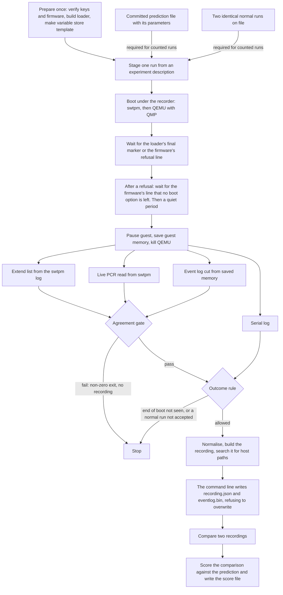

# Lux recorder: design

Status: third version. The first was written before the code. The second matched the package as first built. This one matches the package after an independent review of that build; section 11 lists every point where building or review proved an earlier version wrong or incomplete.

## 1. Purpose and the question

Lux asks one question:

> When one thing in a PC's boot chain is changed, what does the specification require, what does it leave open, and what does this firmware actually do?

The recorder is the part that produces evidence. It boots open-source UEFI firmware (OVMF, built from EDK II) in a QEMU virtual machine with a software TPM (swtpm), captures what the boot left behind, and writes one JSON file per boot. A static site loads those files directly. The recorder also compares two recordings and scores a comparison against a prediction that was committed before the run.

Scope: open-source firmware in a virtual machine with a software TPM, under software emulation. Nothing here describes any vendor's firmware on real hardware.

Two kinds of changed run exist. A **pilot** was run before any prediction existed; it is shown and never counted. A **counted** run needs a committed prediction first, and the recorder enforces that (section 6).

## 2. Pipeline



Every run ends by the same path, whether the loader was accepted or refused.

## 3. Module boundaries

The package is `recorder/`. Modules marked *pure* touch no process, socket or clock; they run on any Python 3.12 and carry most of the tests. Five places reach outside Python: key generation and the loader build (they run Linux tools), `session.QemuMachine` (QEMU and swtpm), `provenance` (it asks `dpkg-query` for versions and reads the system's release file, so the recorder as written is for Debian and Ubuntu), and `prediction.run_git`. Each of them is handed in from outside as a command runner, a machine, a clock or a git query, so tests replace them with fakes.

**`banks`** (*pure*) holds the register arithmetic every other module shares: the four hash banks, the start values, and the extend rule (new value = hash of old value followed by digest).

**`provenance`** reports facts about the host: the versions of the packages a run uses, and the system's name and release number. It also holds the command runner. The provenance block of a recording is put together in `runner`, from these facts, the staged run, the key fingerprints from `keys` and the command lines from `session`. The date is passed in as data, never read inside a function that also builds compared fields.

**`keys`** owns the committed Secure Boot test keys (PK, KEK, db) in `recorder/testkeys/`, and the owner identifier used in every signature list. It loads the keys, checks them against a hash manifest, and reports fingerprints. The manifest also pins the variable store template, the packaged firmware file, and the versions of the tools that created the key set. It can generate keys only through an explicit option that refuses when the directory holds anything besides its README, because PCR 7 depends on the certificate bytes and new keys would silently invalidate every recording.

**`pe`** (*pure*) reads PE/COFF headers: section table, the certificate table (the signature area), and the Authenticode SHA-256 of an image. The recorder uses it to predict the PCR 4 image digest before a boot and to prove where a changed byte lies.

**`loader`** builds the assembly loader with the installed assembler and linker (no timestamp), and verifies the committed signed loader against the manifest. Signing output is not repeatable, so the signed file is a fixed committed artifact, not a build product. It also makes changed copies: one byte inside a section, or one byte inside the signature area, each refused unless `pe` confirms the location.

**`enrol`** (*pure*) builds the small UEFI program that writes the keys through the firmware's `SetVariable` service. Its machine code is written out byte by byte in Python (decision D5).

**`varstore`** (*pure*) reads the variable store file record by record and makes the offline edits experiments need: switch the firmware's enable switch off, reverse `BootOrder`, append a revocation entry.

**`experiments`** (*pure*) holds each experiment as a small frozen description: identifier, kind (`normal`, `pilot`, `counted`), which loader variant goes on the disk, edits to the variable store, firmware file, the one sentence saying what changed, and the names of the parameters its prediction must carry. Descriptions are data. Adding an experiment adds a description, not a code path. Eight exist: `normal`; the pilots `e1`, `e2`, `e4`, `e5`; and the counted `boot-order`, `signature-byte` and `rebuilt-firmware`. A description never holds a value that decides what a counted experiment tests; that value lives in the prediction (section 6).

**`staging`** turns a description into a fresh run directory: boot disk tree, a copy of the template store, the changed loader. It checks the firmware file against its pinned hash and takes an experiment's parameters from the committed prediction only. It does not start anything. Run directories live under a Linux path because unix sockets do not work on the Windows-mounted drive.

**`session`** starts swtpm and QEMU, speaks QMP (the machine protocol QEMU offers on a socket), watches the serial file, and performs the one ending: pause, save memory, kill QEMU while paused, read the PCRs from the still-running swtpm, stop swtpm. QEMU runs under an outer `timeout` in a process group of its own; cleanup kills the group and then checks that nothing of it is left. A `finally` path stops both processes, and a failure deletes the saved guest memory. The waiting logic (`run_boot`) talks only to a `Machine` and a `Clock` interface; `QemuMachine` is the real implementation.

**`preparation`** verifies the keys and the firmware file, builds the loader, and makes the variable store template with one enrolment boot (D4).

**`runner`** records one named run and is the only place where the steps meet, in this order: prediction gate and repeat precondition (counted runs), staging, boot, parsing, agreement gate, outcome rule, recording.

**`capture`** (*pure*) turns raw artifacts into Python values: cleaned console lines, the extend list from the swtpm log, the PCR values from TPM response bytes, and candidate event logs found in saved memory. It also owns the rule that turns console text into an outcome, and builds the one TPM command whose answer it decodes. Malformed TPM data raises `FormatError`, never a bare Python error.

**`eventlog`** (*pure*) parses the event log binary and gives each event a type name and a plain one-line summary. Names follow the ones tpm2-tools prints; they are tool names, not specification citations.

**`gate`** (*pure*) replays the event log and the extend list and compares both with the live read (section 4.3).

**`normalise`** (*pure*) masks the run directory path, rounds wall-clock durations, and finds any string that still looks like a host path so the run can be refused before it is written. It sorts nothing that has a meaningful order.

**`recording`** (*pure*) builds the recording dictionary and writes it deterministically: UTF-8, LF line ends, two-space indent, sorted keys, lowercase hex. It is also the one home of the file hash helper.

**`compare`** (*pure*) compares two recordings on the compared fields only and produces the comparison document (section 5). It also refuses pairs whose comparison would prove nothing, and checks that a comparison really is the repeat precondition.

**`prediction`** (*pure* except one git query) loads and validates prediction files, answers "is a prediction for this experiment committed, and is the file on disk byte for byte the committed one", and scores a comparison against a prediction.

**`storymap`** (*pure*) assigns each event to a story stop from declared rules (section 7).

**`cli`** is the entry point: `prepare`, `record`, `compare`, `check`. Every refusal the recorder raises on purpose, and every loaded document that lacks a field, ends as exit code 1 with one plain sentence. Exit code 3 marks a recorded `timeout` (section 4.4).

**`errors`** defines the small exception family so callers never catch bare exceptions: `GateFailure`, `PredictionMissing`, `StagingRefused`, `ToolMissing` (a program is not installed, or a command failed), `MachineFailure` (the virtual machine or the TPM did not do what a run needs), `RunIncomplete`, `RecordingExists`, `ComparisonRefused`, `KeysRefused`, `FormatError`.

## 4. The recording format

One file per run: `recordings/<run-name>/recording.json`. The raw event log it was built from is stored beside it as `eventlog.bin`, so a reader can decode it with another tool (for example `tpm2_eventlog`) and check the recording against it.

### 4.1 Shape

Hashes and long lines are shortened with `…`; everything else is the committed `normal-1`.

```json
{
  "format": "lux-recording/1",
  "run": {"name": "normal-1", "experiment": "normal", "experiment_sha256": "6698…a352",
          "kind": "normal", "change": "none", "change_detail": null},
  "provenance": {
    "recorded_at": "2026-11-14T…Z",
    "tools": {"qemu": "1:8.2.2+ds-0ubuntu1.18", "ovmf": "2024.02-2ubuntu0.10",
              "swtpm": "0.7.3-0ubuntu5.24.04.1", "binutils": "2.42-4ubuntu2.10", "python": "3.12.3"},
    "host_os": "Ubuntu 24.04",
    "firmware": {"file": "OVMF_CODE_4M.secboot.fd", "sha256": "1286…de8d"},
    "vars_template_sha256": "57ec…cebf",
    "loader": {"file_sha256": "0cb3…8a78", "authenticode_sha256": "00c5…e50f"},
    "keys": {"PK": "…", "KEK": "…", "db": "…"},
    "qemu_command_line": "timeout -s KILL 300 qemu-system-x86_64 … <run-dir>/vars.fd …",
    "swtpm_command_line": "swtpm socket --tpm2 … <run-dir>/tpm …",
    "prediction": null
  },
  "outcome": {"result": "accepted", "refusal_lines": [], "trigger": "final-marker",
              "ending": "paused-then-killed", "settled": true,
              "settle_rule": "after a refusal, the firmware's line that no boot option is left; then no growth of the console file or the TPM log for 3.0 s (at most 30 s in all, else the run is not recorded)"},
  "timing": {"seconds_to_trigger": 4.9, "seconds_to_pause": 7.9},
  "console": ["BdsDxe: loading Boot0001 …", "BdsDxe: starting Boot0001 …",
              "LUX-LOADER A: started, boot services active", "…",
              "LUX-FINAL-MARKER loader idle after ExitBootServices"],
  "loader_report": ["LUX CFG 98584EEE143959429D6EDC7BD79403CF 000000001E4EBE98", "…"],
  "events": [
    {"index": 1, "pcr": 0, "type": "EV_S_CRTM_VERSION", "type_code": "0x00000008",
     "digest_sha256": "d60c…40ea", "summary": "firmware version string 2024.02-2ubuntu0.10",
     "stop": 3, "stop_rule": "pcr0-firmware"}
  ],
  "pcrs": {"sha256": {"0": "…", "23": "…"}, "sha1": {}, "sha384": {}, "sha512": {}},
  "event_log": {"sha256": "0c45…19b7", "bytes": 9793, "events": 28},
  "vars_after_sha256": "…",
  "gate": {"passed": true, "banks": 4, "pcrs_per_bank": 24,
    "checks": {"event_log_replay_equals_live": true, "extend_list_replay_equals_live": true,
      "event_sequence_equals_extend_sequence": true, "all_extends_answered_ok": true,
      "content_digests_match": true, "every_event_carries_all_banks": true,
      "exactly_one_log_candidate": true},
    "counts": {"content_digests_recomputed": 21, "log_candidates_parsed": 1}},
  "may_vary": ["provenance.recorded_at", "run.name", "timing.seconds_to_pause", "timing.seconds_to_trigger"]
}
```

Field notes:

- `run.change_detail` is `null` for a run that changes nothing. Otherwise it is `{"loader_byte": {"file_offset", "old_value", "new_value", "area"} or null, "store_edits": [names], "firmware_replaced": true or false}`. `area` is where the file's own headers place the changed byte (`section .data`, `signature area`), so a reader can check that exactly one byte in that area differs.
- `run.experiment_sha256` is the SHA-256 of the experiment's description as the code held it at the time of the run.
- `provenance.tools` lists only what a run uses. The tools that created the key set once are recorded in `recorder/testkeys/MANIFEST.json`. `host_os` is the system's name and release number without the point release.
- `provenance.prediction` is `null` for normal and pilot runs. For a counted run it holds the prediction file's repository path, SHA-256, the commit that contains it, and its `parameters`.
- `outcome.result` is one of `accepted`, `refused`, `start-failed`, `timeout`. `outcome.refusal_lines` lists every console line in which the firmware gave up on a boot option. The two together can say "one option refused, another accepted" (`accepted` with a non-empty list), which `result` alone cannot.
- `keys` values are SHA-256 fingerprints of the certificates.
- `gate.checks` holds truth values only, and every one must be true. `gate.counts` holds numbers and is never a verdict.

### 4.2 Rules

- **`may_vary` is the complete list of fields a comparison ignores.** Everything else must match between two normal runs. The list is a constant of the package; a recording that carries a different list is reported as differing, so a field cannot be hidden by adding it. The raw swtpm log and swtpm's saved state differ between identical boots and are therefore never part of a recording.
- Paths under the run directory are written as `<run-dir>`, so no user name or machine path reaches the repository.
- **The console is stored as two lists.** `console` holds the firmware's lines and the loader's status lines; these carry the story. `loader_report` holds the loader's dump of the memory map and the configuration tables: exactly the lines that begin with `LUX MM ` or `LUX CFG `. They are raw addresses. Both lists are compared fields, and every cleaned console line is in exactly one of them.
- **Events are always shown in `index` order. `stop` is a label, not a position.** In a refused boot the stops do not rise steadily (section 7), so grouping events by `stop` would show them out of order.
- An event's `summary` is derived from the event's own data. For events whose digest is defined by their content (variables, separators, action strings, the version string), the recorder recomputes the digest; a mismatch fails the gate, and the number of matches is in `gate.counts`.
- Guest memory is deleted as soon as the event log is cut out of it, and also when any step after saving it fails. It is never committed.

### 4.3 The agreement gate

Three readings of the same boot, taken by different routes, must agree on all 24 PCRs in all four hash banks:

1. replay of the event log (start value, then new = hash of old followed by digest, per event);
2. replay of the extend commands found in the swtpm log;
3. the live read from the TPM after the guest was paused.

How independent they are: the event log is written by the firmware and cut out of guest memory, so it does not pass through the TPM at all. Readings 2 and 3 both come from the one swtpm process, by two routes (its debug log, and its answer to a read command). Replays 1 and 2 share one extend function, so only the comparison with reading 3 can expose a wrong extend rule.

Additional conditions: event *n* and extend *n* carry the same PCR and digests for every *n*; the TPM answered every extend with success; every digest that is defined by the event's own data equals a fresh hash of that data (an event with no digest in a known bank counts as a mismatch, not as nothing to check); the log's header, every extended event and the live read name the same four banks; **exactly one** memory candidate parses as an event log. A run whose guest ended by itself has no live read and fails the gate. The log is chosen by structure and then tested, never chosen because its replay matches. A failed gate raises `GateFailure`, the command exits non-zero, and no recording is written.

### 4.4 The outcome rule

After the gate, two more rules decide whether a boot may become a recording:

- **The end of the boot must have been seen.** For an accepted boot that is the loader's final marker followed by a quiet period. For a refused boot it is the firmware's own line that no boot option is left (`BdsDxe: No bootable option …` or `BdsDxe: Press any key …`), and then the quiet period. If neither is reached within the settle limit, `outcome.settled` would be false, and the run is refused with `RunIncomplete`. A recording therefore always has `settled: true`.
- **A normal run has one allowed result, `accepted`.** A hung or refused normal run is a broken setup. Two hung runs would otherwise compare as identical and satisfy the repeat precondition.

A changed run that reached neither the marker nor a refusal is recorded as `timeout`, because that can be the true result of a change. The `record` command then exits with code 3, so that a script cannot take it for an ordinary run.

`record` refuses to write over an existing recording unless `--replace` is given, and it never replaces the recording of a counted experiment.

## 5. The comparison format

`compare` takes a baseline and a changed recording and writes the document below. This is the committed `normal-1_vs_e2.json`; hashes are shortened, `pcrs_same` is cut to one bank, and the four events only in the baseline are cut to the first. Nothing else is left out.

```json
{
  "format": "lux-comparison/1",
  "baseline": {"run": "normal-1", "experiment": "normal", "kind": "normal", "recording_sha256": "…"},
  "changed": {"run": "e2", "experiment": "e2", "kind": "pilot", "recording_sha256": "…"},
  "identical": false,
  "outcome": {"baseline": "accepted", "changed": "refused"},
  "refusal_lines": {"baseline": [], "changed": ["BdsDxe: failed to load Boot0001 … Access Denied"]},
  "first_differing_event": {"index": 25, "stop": 6,
    "baseline": {"pcr": 7, "type": "EV_EFI_VARIABLE_AUTHORITY", "digest_sha256": "3af9…9ece"},
    "changed": {"pcr": 4, "type": "EV_EFI_ACTION", "digest_sha256": "7044…28a6"}},
  "pcrs_differing": {"sha1": [4, 5, 7], "sha256": [4, 5, 7], "sha384": [4, 5, 7], "sha512": [4, 5, 7]},
  "pcrs_same": {"sha256": [0, 1, 2, 3, 6, 8, 9, 10, 11, 12, 13, 14, 15, 16, 17, 18, 19, 20, 21, 22, 23]},
  "events_only_in_baseline": [{"index": 25, "pcr": 7, "type": "EV_EFI_VARIABLE_AUTHORITY", "digest_sha256": "3af9…9ece"}],
  "events_only_in_changed": [
    {"index": 25, "pcr": 4, "type": "EV_EFI_ACTION", "digest_sha256": "7044…28a6"},
    {"index": 26, "pcr": 4, "type": "EV_EFI_ACTION", "digest_sha256": "3d67…33ba"}],
  "console_first_differing_line": 2,
  "loader_report_first_differing_line": 1,
  "other_fields_differing": ["event_log.bytes", "event_log.events", "event_log.sha256",
    "gate.counts.content_digests_recomputed", "outcome.trigger",
    "provenance.loader.authenticode_sha256", "provenance.loader.file_sha256"]
}
```

Events are matched as (PCR, type, SHA-256 digest) in log order. "Only in one run" lists events with no equal partner in the other run; partners are used up one by one, so an event that occurs twice in one run and once in the other is listed once. Registers are compared in all four banks and all 24 indexes. `other_fields_differing` lists every remaining differing field as a dotted path. Left out of it are the `may_vary` fields, the parts with their own block (events, registers, both console lists, the outcome), and the fields that say which experiment a run is (`run.experiment`, `run.experiment_sha256`, `run.kind`, `run.change`, `run.change_detail`): those differ for every experiment by definition, and both experiments are named in the header.

With `identical: true` every difference field is empty. Comparison files live in `recordings/comparisons/<baseline>_vs_<changed>.json`.

**Pairs that are refused.** `compare` exits with an error and writes nothing when both files have the same hash, when both recordings carry the same `recorded_at` (a renamed copy differs only in fields a comparison ignores, so it would otherwise come out identical), when either recording's `gate.passed` is not true, or when the baseline is not a recording of the normal run.

**The repeat precondition.** Two normal runs must match before any experiment counts. In code that is a comparison whose two sides are both `normal`, are two different recordings, and are `identical`. `record` requires it on disk before a counted experiment is booted (the two recordings it names must still have the stored hashes), and `check` requires it again, for the same baseline, before a counted run is scored.

## 6. The prediction file format

One file per counted experiment: `predictions/<experiment-id>.json`.

```json
{
  "format": "lux-prediction/1",
  "experiment": "signature-byte",
  "written": "2026-11-20",
  "change": "one byte changed inside the loader's signature area, Secure Boot on",
  "parameters": {"signature_area_offset": 64},
  "rows": [
    {"id": "refused", "field": "outcome.changed", "expect": "refused",
     "basis": "uefi-required",
     "citation": {"document": "UEFI Specification", "version": "2.11",
                  "section": "(section title)", "page": 0}},
    {"id": "pcr4", "field": "pcrs_differing.sha256", "expect_contains": [4],
     "basis": "tcg-unread", "citation": null,
     "reason": "seen in the pilot e2 on this firmware"}
  ]
}
```

The example shows the shape only. Its values, the citation included, are placeholders and not a prediction.

The four basis labels:

| Label | Meaning | What the row must carry |
|---|---|---|
| `uefi-required` | Required by UEFI 2.11 | Section title and page |
| `uefi-platform` | UEFI 2.11 says so in words and leaves the choice to the platform | Section title and page |
| `tcg-unread` | Belongs to a Trusted Computing Group document that has not yet been read | No citation; a reason |
| `this-firmware` | This firmware's own behaviour | A `source`: a source file or an earlier recording |

Validation rejects a row whose label and citation do not fit this table. Pages are page numbers of the published PDF file.

A row's `field` is a dotted path into the comparison document of section 5, and it carries exactly one expectation: `expect` (the field equals this value), `expect_contains` (the field is a list holding all of these) or `expect_excludes` (the field is a list holding none of these). A field the comparison does not have is an error, never a pass.

**Parameters.** Some experiments need a value that decides what they test. Such a value is part of the prediction, never of the code or the command line:

| Experiment | Parameter | Meaning |
|---|---|---|
| `signature-byte` | `signature_area_offset` | Which byte of the signature area is changed, counted from the start of that area. The area holds a certificate header, the signature itself and padding; the choice of byte decides what the experiment tests |
| `rebuilt-firmware` | `firmware_sha256` | SHA-256 of the rebuilt firmware file. Staging refuses any other file |
| `boot-order` | none | |

A prediction must carry exactly the parameters its experiment names. Staging reads them from the committed prediction, and the recording stores them.

**The rule.** `record` refuses to start a `counted` experiment unless all of this holds:

1. its prediction file exists and validates;
2. the file names this experiment, its `change` sentence is word for word the experiment's, and its parameters are exactly the ones the experiment needs;
3. git tracks the file, reports no uncommitted change, can name the commit that last changed it, and that commit is part of the current history;
4. the bytes on disk have the same SHA-256 as the file read out of that commit. Git's "nothing changed" answer is not trusted alone, because git can be told to stop looking at a file;
5. the repeat precondition holds on disk (section 5).

If git cannot answer, the answer is no. The recording stores the prediction's path, SHA-256, commit and parameters, and the fingerprint of the experiment's description.

### 6.1 The score format

`check` scores a comparison against the prediction and, with `--out`, writes the result:

```json
{
  "format": "lux-score/1",
  "experiment": "signature-byte",
  "run": "signature-byte-1",
  "prediction": {"path": "predictions/signature-byte.json", "sha256": "…", "commit": "…",
                 "parameters": {"signature_area_offset": 64}},
  "comparison_sha256": "…",
  "baseline_recording_sha256": "…",
  "changed_recording_sha256": "…",
  "repeat_comparison_sha256": "…",
  "required_met": 1, "required_total": 1,
  "open_correct": 1, "open_total": 1,
  "mismatches": [],
  "rows": [{"id": "refused", "basis": "uefi-required", "held": true},
           {"id": "pcr4", "basis": "tcg-unread", "held": true}]
}
```

The result is two pairs of numbers: `uefi-required` rows met, and open rows (the other three labels) predicted correctly. A mismatch is reported as a mismatch, by row identifier. Exit code 0 means "scored", not "every row held".

`check` refuses to score when the comparison was not made from the given recording or the given baseline, when the baseline is not a normal run, when the prediction file no longer has the hash stored in the recording (so a prediction cannot be edited after its run without the check saying so), when the experiment's description no longer has the fingerprint stored in the recording, or, for a counted run, when the repeat comparison is missing or is not about the same baseline.

## 7. Event to story stop

The site tells the boot as seven stops: reset, SEC, PEI, DXE, BDS, load and verify, handoff. **UEFI 2.11 does not define SEC, PEI, DXE or BDS**, and the event log carries no timestamps or phase markers. The mapping is therefore this project's own, declared as rules in `storymap`, and each rule states its basis.

| Rule | Events | Stop | Basis |
|---|---|---|---|
| `pcr0-firmware` | Version string and firmware blobs in PCR 0 | 3 | Log order observed; phase attribution from EDK II documentation, not yet confirmed in source |
| `pcr7-policy` | Secure Boot variables in PCR 7, and any separator in PCR 7 | 4 | Same |
| `pcr1-config` | Platform configuration and boot variables in PCR 1 | 5 | Same |
| `boot-attempt` | "Calling EFI Application" action, separators for PCR 0 to 6 | 5 | Observed position, directly before the load |
| `load-verify` | Authority record in PCR 7, image digest in PCR 4 | 6 | Observed: present when the loader is accepted, absent when it is refused |
| `boot-return` | "Returning from EFI Application" action | 6 | Observed: logged only when a boot option hands control back, here after a refused load |
| `exit-boot-services` | The two exit actions in PCR 5 | 7 | Observed: only after the loader's exit call |

Stops 1 and 2 have no events and the recording says so. An event matching no rule gets `stop: null`, and a test fails if that happens in a committed recording.

**Stops are labels and do not always rise.** In the refused pilot `e2` the last three events carry stops 5, 6, 5: the first boot option is called (`boot-attempt`), the firmware gives it up (`boot-return`), and then calls the next option (`boot-attempt` again). The site must render events in `index` order and may use `stop` only to label them. A test pins that sequence.

## 8. Decisions

### D1. The guest loader is assembly, built with the installed assembler

*Context.* The loader must call `ExitBootServices`, print a final marker and then idle. No C compiler is installed and nothing may be downloaded.
*Chosen.* About 190 lines of commented assembly, linked without a timestamp.
*Weighed.* C (clearer, but needs a compiler download); Python that emits machine code (deterministic, but the bytes are harder to read than assembly).
*Consequences.* One toolchain, a byte-identical unsigned build, and a predictable image digest. **Cost:** readers who know Python must read assembly to trust the loader, and each new guest behaviour is slow to add.

### D2. The test keys are generated once and committed

*Context.* PCR 7 contains the certificate bytes, so two machines with different keys can never produce equal recordings.
*Chosen.* PK, KEK and db are generated once with a fixed owner identifier and fixed timestamps, and committed with their private halves, the signed loader and a hash manifest.
*Weighed.* Keys per machine (breaks reproduction); the distribution's packaged test store (one certificate in all three roles, leftover boot entries).
*Consequences.* Anyone can reproduce PCR 7 exactly. **Cost:** private keys sit in a public repository. They are test keys for this virtual machine only and must never be trusted anywhere; the README beside them says so, and secret scanners may still flag them. **A second cost, observed:** the certificates are valid from the day they were generated, which is later than the guest's fixed clock, so at guest time they are not yet valid. This firmware accepts them all the same. A firmware that compares validity dates with the clock would refuse them, and the keys must not be regenerated to change that.

### D3. Every run ends by pause, capture, kill

*Context.* When the guest powers off, QEMU tells swtpm to stop and the PCRs are gone before they can be read.
*Chosen.* The loader idles; the recorder pauses the guest, saves memory, and kills QEMU while paused, so swtpm stays alive for the live read. Refused boots take the same path.
*Weighed.* Guest power-off (loses the live read and the event log); a guest program that reads the log itself (changes the measurements it reports).
*Consequences.* One ending for every outcome and a three-way check. **Cost:** a 512 MiB memory file per run that must be deleted, a signature search to find the log, and an end condition that still ends in a quiet period. For a refused boot the quiet period starts only after a line the firmware prints itself; for an accepted boot, after the loader's marker.

### D4. The variable store template is rebuilt, not committed

*Context.* Every run must start from the same variable store with the keys enrolled, and enrolling is itself a boot.
*Chosen.* `prepare` boots the firmware's empty packaged store once with the enrolment program and keeps the result as the template in the work directory. Its SHA-256 is pinned in the key manifest, and `prepare` and `record` refuse a template with another hash. Every recorded run is therefore the second boot of the same store. The enrolment boot is a preparation boot, not a recorded run: its program is unsigned and runs before a platform key exists, and it powers the machine off itself.
*Weighed.* Committing the 528 KiB template file (simpler, but a binary derived from a distribution package, and nobody could see how it was made).
*Consequences.* Two independent preparations on one machine gave the same hash, so the template is a function of the committed keys and the packaged firmware. **Cost:** this has been shown on one machine and one firmware package only; another package version may give another template, and `prepare` would then refuse it.

### D5. The enrolment program is machine code written out in Python

*Context.* The keys are enrolled by a small UEFI program that calls `SetVariable` three times. D1 rejected "Python that emits machine code" for the loader because the bytes are harder to read than assembly. The enrolment program does exactly that, so the choice needs its own reason.
*Chosen.* `enrol` writes the program's instructions byte by byte, each with the instruction it encodes in a comment, and wraps them in a PE32+ file whose header fields are named constants.
*Weighed.* A second assembly source built like the loader, with the signed updates pulled in as data. It would read like the loader does. But the program's data is the three signed updates, about 6 KiB that differ per key set, so the build would depend on the key files as well as on the assembler, and its output would have to be pinned and re-verified by one more enrolment boot.
*Consequences.* The program is a pure function of the key files, the same on every machine, with no build step and no tool version in its way. A test pins its SHA-256 for the committed keys, so a change to the builder that alters one byte fails. **Cost:** this is the one module a Python reader cannot check line by line without an instruction reference; about eighty instructions must be taken on trust or disassembled. It is a preparation step: nothing it prints or does enters a recording except through the variable store, whose hash is pinned.

## 9. Risks that could mislead a reader

| # | Failure | Why it misleads | Covered by |
|---|---|---|---|
| 1 | A run with disagreeing readings is published | The PCR table would not follow from the event list | `test_eventlog_gate`: a one-bit change in one digest or one live value must fail the gate; `test_session_runner`: a failing gate raises, the command exits non-zero and writes no file |
| 2 | The wrong memory region is taken as the event log | Events shown were never extended | `test_capture`: decoy headers are not candidates; `test_session_runner`: zero or two parsing candidates raise |
| 3 | A counted run starts without a committed prediction, or with one edited behind git's back | The headline numbers would not be blind | `test_compare_prediction`: a real temporary git repository covers untracked, staged, committed, modified and a file hidden from `git status`; fakes cover the rest; `test_session_runner`: all three counted experiments are refused before any machine is created |
| 4 | Keys are regenerated unnoticed | Every PCR 7 value changes with no visible cause | `test_staging`: generation refuses a directory that holds keys; a changed, missing or extra file fails verification |
| 5 | A varying field leaks into the comparison, or a compared field is hidden in `may_vary` | False differences, or real ones masked | `test_compare_prediction`: recordings differing only in `may_vary` are identical; any other single-field change is reported; a longer `may_vary` list is itself reported |
| 6 | A refused boot is paused before its last extends | The changed run looks shorter than it is | `test_session_runner`: a refusal followed by ten quiet seconds is not paused until the firmware's last line has appeared; a refusal whose end never comes is not settled and is not recorded. Remaining risk: extends that happen later than three quiet seconds after that last line |
| 7 | The changed byte lands in the wrong area, or is chosen after the result is known | A signature-area change reported as a content change; a prediction that fits because the byte was picked to fit | `test_staging`: location proven from headers, wrong area refused, offset taken from prediction parameters only; `test_session_runner`: the recording stores offset, values and area |
| 8 | A type name or stop is wrong | The story attaches an event to the wrong step | `test_eventlog_gate` against the type names tpm2-tools printed, kept as a fixture; `test_story_and_repository` requires every real event to match exactly one rule and pins the 5, 6, 5 ending of the refused boot |
| 9 | A hung boot is taken for a normal run | Two hung runs are identical and would satisfy the repeat precondition | `test_session_runner`: a normal run that is not `accepted` raises and writes nothing; a recorded `timeout` gives exit code 3 |
| 10 | A recording is compared with itself or a copy | "Identical" without a second boot | `test_compare_prediction` and `test_session_runner`: same hash, same recording time, failed gate and a baseline that is not normal are each refused |
| 11 | A recording is overwritten | A counted experiment could be repeated until its result pleases; committed evidence could be lost | `test_session_runner`: an existing name is refused before any boot; `--replace` is needed; a counted recording is never replaced |
| 12 | The firmware package changes unnoticed | PCR 0 and every later value change with no visible cause | `test_staging`, `test_session_runner`: a missing or different firmware file is refused in staging and in preparation |
| 13 | A virtual machine is left running | An idling guest runs for ever and may disturb later runs | The process group is killed and then checked; the integration test and `scripts/check-clean.sh` look for leftover processes. Not covered by a unit test, because it needs real processes |

## 10. Test mix

The standard library `unittest` runs everywhere; no test runner is installed inside Linux, and nothing is installed for this project. Command: `python3 -m unittest discover -s recorder/tests -t .`

- **Unit tests on pure modules, the large majority.** Parsers and the gate are tested with small byte fixtures built in the test itself, so a failure points at one function. Each has a negative case that must fail.
- **Fixture tests.** Real data from one accepted and one refused boot is committed in `recorder/tests/fixtures/`: the raw event log, the registers read from the TPM, the raw console file, the TPM command traffic from the swtpm debug log, and the type names tpm2-tools printed. They pin the two undocumented formats the recorder depends on, and they let the whole agreement gate run on real evidence without a virtual machine. They were made with an earlier, throwaway key set, so their register 7 differs from the committed recordings.
- **Tests with fakes for `session`, `runner`, `preparation` and `staging`.** A fake machine and a fake clock exercise the ending path, the timeout and the cleanup without booting anything. A whole run is recorded from the fixtures through the real pipeline. All eight experiment descriptions are staged, including those that may not yet be run.
- **One test class against real git.** The prediction gate is run against a temporary repository made with the installed `git`, so the commands the gate sends are proven and not only the answers a fake gives. It is skipped where `git` is not installed.
- **Refusal tests.** Prediction gate, key regeneration, overwriting, self-comparison and the outcome rule, as listed in section 9.
- **Committed recordings.** `test_committed_recordings` checks that the recordings in the repository still follow from their own event logs, still compare as published, may be compared, and satisfy the repeat precondition.
- **One integration test, skipped unless `LUX_VM_TESTS=1`.** It boots the normal run twice, asserts the agreement gate passed, that the two runs are equal on every compared field, that a fresh run equals the committed `normal-1`, and that no process is left. It never runs a changed boot.
- **Mutation checks.** Four rules the question depends on were broken on purpose to confirm a test fails; see `docs/MUTATION_CHECKS.md`.

Not tested: behaviour on another QEMU version or machine type, hardware acceleration, a second machine, whether a third boot of one variable store equals the second, and the real process cleanup when QEMU is killed from outside.

## 11. What building and review changed in this design

| # | An earlier version said | As built, and why |
|---|---|---|
| 1 | `may_vary` holds the date and two durations | `run.name` is in it too. Two normal runs must have different names and must still compare as identical |
| 2 | The comparison lists registers for SHA-256 | It lists all four banks and all 24 indexes. The gate proves all four banks, so the comparison should not narrow that silently |
| 3 | A prediction row's field was `outcome.result` | Fields are paths into the comparison document, so that row reads `outcome.changed`. `expect_excludes` was added, because "this register does not change" is half of every prediction |
| 4 | The gate block had six checks | `content_digests_match` was added beside the count, so a digest that does not describe its own data fails the gate instead of only lowering a number |
| 5 | The two real boots are run by hand, not by the test suite | An integration test exists and is skipped by default, so the repeat precondition can be proven again with one command |
| 6 | Five experiment descriptions | Eight: the normal run, four pilots and three counted ones |
| 7 | Modules as first listed | `banks`, `enrol`, `varstore`, `preparation` and `runner` were added; nothing was merged |
| 8 | The template's origin was not decided | D4: rebuilt by an enrolment boot and pinned by hash |
| 9 | Keys have fixed timestamps | The signed updates do (`2026-01-01 00:00:00`). The certificates' validity dates are the generation day, because the installed OpenSSL cannot fix them. The certificates are committed, so this does not affect reproduction; D2 records what it does mean |
| 10 | The outcome had three fields | It has six. `settle_rule` states the end condition every recording was made under; `settled` and `refusal_lines` were added in review |
| 11 | Only `recording.json` per run | `eventlog.bin` is stored beside it as the raw evidence |
| 12 | The prediction gate asked git whether the file was tracked and unmodified | It also reads the committed file out of git and compares hashes. Review showed that a file hidden from `git status` passed |
| 13 | The signature byte was a field of the experiment description; the rebuilt firmware was any path on the command line | Both are parameters of the committed prediction, and the prediction's `change` sentence must equal the experiment's. Otherwise what a counted experiment changes could be chosen after its prediction |
| 14 | Any boot that passed the agreement gate was recorded | Section 4.4: the end of the boot must have been seen, and a normal run must be accepted |
| 15 | A refused boot ended after a quiet period alone | The quiet period starts only after the firmware's own last line |
| 16 | `compare` compared any two files | It refuses a recording with itself, a copy, a failed gate, and a baseline that is not normal. The repeat precondition is checked before a counted run and before a score |
| 17 | `record` wrote over an existing recording | It refuses, unless `--replace` is given, and never for a counted experiment |
| 18 | The provenance listed every installed tool and the full system name | Only what a run uses, and the release number without the point release. A clone without the key-creation tools, or a point release, must not make two equal boots compare as different |
| 19 | The gate block mixed truth values and counts | `checks` and `counts` are separate, and two checks were added: one log candidate, and the same four banks everywhere |
| 20 | One `console` list | `console` and `loader_report`, so the site need not guess a filter |
| 21 | The story rule `authorise` covered the returning action too | `load-verify` and `boot-return`; stops are documented as labels |
| 22 | `check` printed three lines | It also writes `lux-score/1`, which the site loads for the headline numbers |
| 23 | Which byte the pilot changed was computed and dropped | `run.change_detail` stores it |
| 24 | QEMU was killed through its pid file | The process group is killed and checked; a QEMU that never started is reported with its own error text |
| 25 | The firmware file was whatever the package installed | Its hash is pinned in the key manifest and checked before every run |

The recording format is still called `lux-recording/1`. Its shape changed in review (rows 10, 18, 19, 20, 23), before any site or other reader depended on it, and all three committed recordings were made again with the new shape. Their register values and event logs are the same as before.

### Staged but never run

The recorder can stage `e1`, `e4`, `e5`, `boot-order`, `signature-byte` and `rebuilt-firmware`, and tests cover the staging. None of them has been booted with this package. Three points are therefore unproven and must be settled when each prediction is written:

- `boot-order` reverses `BootOrder` in the store file while the machine is off. UEFI 2.11 (chapter 3 Boot Manager, opening text, PDF page 152) guarantees that a change to the boot order takes effect only after the next reset. This project's staging additionally needs two bootable entries, which is its own condition and not a quoted requirement. Whether the offline edit meets both is not established.
- `e5` appends a `dbx` record to the store file directly. Whether the firmware accepts a record written this way has not been observed.
- `signature-byte` has no byte chosen. The byte is a parameter of the prediction (section 6), and the recorder refuses the run until a committed prediction names it.
