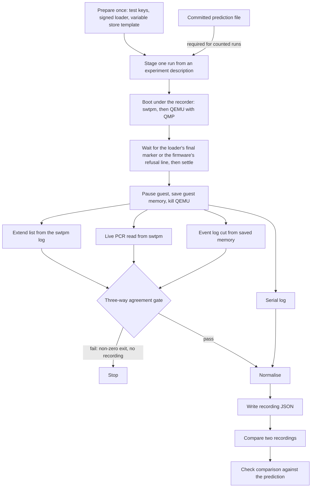

# Lux recorder: design

Status: second version. The first was written before the code; this one matches the package as built. Section 11 lists every point where building proved the first version wrong or incomplete.

## 1. Purpose and the question

Lux asks one question:

> When one thing in a PC's boot chain is changed, what does the specification require, what does it leave open, and what does this firmware actually do?

The recorder is the part that produces evidence. It boots open-source UEFI firmware (OVMF, built from EDK II) in a QEMU virtual machine with a software TPM (swtpm), captures what the boot left behind, and writes one JSON file per boot. A static site loads those files directly. The recorder also compares two recordings and checks a comparison against a prediction that was committed before the run.

Scope: open-source firmware in a virtual machine with a software TPM, under software emulation. Nothing here describes any vendor's firmware on real hardware.

Two kinds of changed run exist. A **pilot** was run before any prediction existed; it is shown and never counted. A **counted** run needs a committed prediction first, and the recorder enforces that (section 6).

## 2. Pipeline



Every run ends by the same path, whether the loader was accepted or refused.

## 3. Module boundaries

The package is `recorder/`. Modules marked *pure* touch no process, socket or clock; they run on any Python 3.12 and carry most of the tests. Only key generation, the loader build and `session.QemuMachine` need the Linux tools, and each of them receives its command runner, machine and clock from outside, so tests replace them with fakes.

**`banks`** (*pure*) holds the register arithmetic every other module shares: the four hash banks, the start values, and the extend rule (new value = hash of old value followed by digest).

**`provenance`** collects what a reader needs to reproduce a run: package versions as the package manager reports them, the SHA-256 of the firmware file, key fingerprints, and the full command lines. The date is passed in as data, never read inside a function that also builds compared fields.

**`keys`** owns the committed Secure Boot test keys (PK, KEK, db) in `recorder/testkeys/`. It loads them, checks them against a hash manifest, and reports fingerprints. It can generate keys only through an explicit option that refuses when the directory holds anything besides its README, because PCR 7 depends on the certificate bytes and new keys would silently invalidate every recording.

**`pe`** (*pure*) reads PE/COFF headers: section table, the certificate table (the signature area), and the Authenticode SHA-256 of an image. The recorder uses it to predict the PCR 4 image digest before a boot and to prove where a changed byte lies.

**`loader`** builds the assembly loader with the installed assembler and linker (no timestamp), and verifies the committed signed loader against the manifest. Signing output is not repeatable, so the signed file is a fixed committed artifact, not a build product. It also makes changed copies: one byte inside a section, or one byte inside the signature area, each refused unless `pe` confirms the location.

**`enrol`** (*pure*) builds the small UEFI program that writes the keys through the firmware's `SetVariable` service. Its machine code is written out byte by byte in Python, so it needs no compiler and is the same on every machine.

**`varstore`** (*pure*) reads the variable store file record by record and makes the offline edits experiments need: switch the firmware's enable switch off, reverse `BootOrder`, append a revocation entry.

**`experiments`** (*pure*) holds each experiment as a small frozen description: identifier, kind (`normal`, `pilot`, `counted`), which loader variant goes on the disk, edits to the variable store, firmware file, and the one sentence saying what changed. Descriptions are data. Adding an experiment adds a description, not a code path. Eight exist: `normal`; the pilots `e1`, `e2`, `e4`, `e5`; and the counted `boot-order`, `signature-byte` and `rebuilt-firmware`.

**`staging`** turns a description into a fresh run directory: boot disk tree, a copy of the template store, the changed loader. It does not start anything. Run directories live under a Linux path because unix sockets do not work on the Windows-mounted drive.

**`session`** starts swtpm and QEMU, speaks QMP (the machine protocol QEMU offers on a socket), watches the serial file, and performs the one ending: pause, save memory, kill QEMU while paused, read the PCRs from the still-running swtpm, stop swtpm. QEMU always runs under an outer timeout, and a `finally` path kills both processes. The waiting logic (`run_boot`) talks only to a `Machine` and a `Clock` interface; `QemuMachine` is the real implementation.

**`preparation`** verifies the keys, builds the loader, and makes the variable store template with one enrolment boot (section 8, D4).

**`runner`** records one named run and is the only place where the steps meet, in this order: prediction gate, staging, boot, parsing, agreement gate, recording.

**`capture`** (*pure parsers*) turns raw artifacts into Python values: cleaned console lines, the extend list from the swtpm log, the PCR values from TPM response bytes, and candidate event logs found in saved memory.

**`eventlog`** (*pure*) parses the event log binary and gives each event a type name and a plain one-line summary. Names follow the ones tpm2-tools prints; they are tool names, not specification citations.

**`gate`** (*pure*) replays the event log and the extend list and compares both with the live read (section 4.3).

**`normalise`** (*pure*) masks the run directory path, rounds wall-clock durations, and finds any string that still looks like a host path so the run can be refused before it is written. It sorts nothing that has a meaningful order.

**`recording`** (*pure*) builds the recording dictionary and writes it deterministically: UTF-8, LF line ends, two-space indent, sorted keys, lowercase hex.

**`compare`** (*pure*) compares two recordings on the compared fields only and produces the comparison document (section 5).

**`prediction`** (*pure* except one git query) loads and validates prediction files, answers "is a prediction for this experiment committed and unmodified", and scores a comparison against a prediction.

**`storymap`** (*pure*) assigns each event to a story stop from declared rules (section 7).

**`cli`** is the entry point: `prepare`, `record`, `compare`, `check`. Every failure is a non-zero exit code with one plain sentence.

**`errors`** defines the small exception family (`GateFailure`, `PredictionMissing`, `StagingRefused`, `ToolMissing`, `KeysRefused`, `FormatError`) so callers never catch bare exceptions.

## 4. The recording format

One file per run: `recordings/<run-name>/recording.json`. The raw event log it was built from is stored beside it as `eventlog.bin`, so a reader can decode it with another tool (for example `tpm2_eventlog`) and check the recording against it.

### 4.1 Shape

```json
{
  "format": "lux-recording/1",
  "run": {"name": "normal-1", "experiment": "normal", "kind": "normal",
          "change": "none"},
  "provenance": {
    "recorded_at": "2026-11-14T10:00:00Z",
    "tools": {"qemu": "…", "ovmf": "…", "swtpm": "…", "tpm2-tools": "…",
              "sbsigntool": "…", "efitools": "…", "binutils": "…", "python": "…"},
    "host_os": "Ubuntu 24.04",
    "firmware": {"file": "OVMF_CODE_4M.secboot.fd", "sha256": "…"},
    "vars_template_sha256": "…",
    "loader": {"file_sha256": "…", "authenticode_sha256": "…"},
    "keys": {"PK": "…", "KEK": "…", "db": "…"},
    "qemu_command_line": "timeout -s KILL 300 qemu-system-x86_64 … <run-dir>/vars.fd …",
    "swtpm_command_line": "swtpm socket --tpm2 … <run-dir>/tpm …",
    "prediction": null
  },
  "outcome": {"result": "accepted", "trigger": "final-marker", "ending": "paused-then-killed",
              "settle_rule": "no growth of the console file or the TPM log for 3.0 s (at most 30 s)"},
  "timing": {"seconds_to_trigger": 5.8, "seconds_to_pause": 8.8},
  "console": ["BdsDxe: loading Boot0001 …", "…"],
  "events": [
    {"index": 1, "pcr": 0, "type": "EV_S_CRTM_VERSION", "type_code": "0x00000008",
     "digest_sha256": "…", "summary": "firmware version string 2024.02-2ubuntu0.10",
     "stop": 3, "stop_rule": "pcr0-firmware"}
  ],
  "pcrs": {"sha256": {"0": "…", "23": "…"}, "sha1": {}, "sha384": {}, "sha512": {}},
  "event_log": {"sha256": "…", "bytes": 9657, "events": 28},
  "vars_after_sha256": "…",
  "gate": {"passed": true, "banks": 4, "pcrs_per_bank": 24, "checks": {
    "event_log_replay_equals_live": true, "extend_list_replay_equals_live": true,
    "event_sequence_equals_extend_sequence": true, "all_extends_answered_ok": true,
    "content_digests_match": true, "content_digests_recomputed": 21, "log_candidates_parsed": 1}},
  "may_vary": ["provenance.recorded_at", "run.name", "timing.seconds_to_pause", "timing.seconds_to_trigger"]
}
```

`outcome.result` is one of `accepted`, `refused`, `timeout`. `provenance.prediction` is `null` for normal and pilot runs; for a counted run it holds the prediction file's path, SHA-256 and the commit that contains it. `keys` values are SHA-256 fingerprints of the certificates.

### 4.2 Rules

- **`may_vary` is the complete list of fields a comparison ignores.** Everything else must match between two normal runs. The list is a constant of the package; a recording that carries a different list is reported as differing, so a field cannot be hidden by adding it. The raw swtpm log and swtpm's saved state differ between identical boots and are therefore never part of a recording.
- Paths under the run directory are written as `<run-dir>`, so no user name or machine path reaches the repository.
- An event's `summary` is derived from the event's own data. For events whose digest is defined by their content (variables, separators, action strings, the version string), the recorder recomputes the digest and counts the matches in the gate block.
- Guest memory is deleted as soon as the event log is cut out of it; it is never committed.

### 4.3 The agreement gate

Three independent readings of the same boot must agree on all 24 PCRs in all four hash banks:

1. replay of the event log (start value, then new = hash of old followed by digest, per event);
2. replay of the extend commands found in the swtpm log;
3. the live read from the TPM after the guest was paused.

Additional conditions: event *n* and extend *n* carry the same PCR and digests for every *n*; the TPM answered every extend with success; every digest that is defined by the event's own data equals a fresh hash of that data; **exactly one** memory candidate parses as an event log. A run whose guest ended by itself has no live read and fails the gate. The log is chosen by structure and then tested, never chosen because its replay matches. A failed gate raises `GateFailure`, the command exits non-zero, and no recording is written.

## 5. The comparison format

`compare` takes a baseline and a changed recording and writes:

```json
{
  "format": "lux-comparison/1",
  "baseline": {"run": "normal-1", "recording_sha256": "…"},
  "changed": {"run": "e2", "recording_sha256": "…"},
  "identical": false,
  "outcome": {"baseline": "accepted", "changed": "refused"},
  "first_differing_event": {"index": 25, "stop": 6,
    "baseline": {"pcr": 7, "type": "EV_EFI_VARIABLE_AUTHORITY", "digest_sha256": "…"},
    "changed": {"pcr": 4, "type": "EV_EFI_ACTION", "digest_sha256": "…"}},
  "pcrs_differing": {"sha1": [4, 5, 7], "sha256": [4, 5, 7], "sha384": [4, 5, 7], "sha512": [4, 5, 7]},
  "pcrs_same": {"sha256": [0, 1, 2, 3, 6, 8, 9, 10]},
  "events_only_in_baseline": [{"index": 25, "pcr": 7, "type": "EV_EFI_VARIABLE_AUTHORITY", "digest_sha256": "…"}],
  "events_only_in_changed": [],
  "console_first_differing_line": 2,
  "other_fields_differing": []
}
```

Events are matched as (PCR, type, SHA-256 digest) in log order. "Only in one run" lists events with no equal partner in the other run; partners are used up one by one, so an event that occurs twice in one run and once in the other is listed once. Registers are compared in all four banks and all 24 indexes (the example above is shortened). `other_fields_differing` lists every remaining field outside `may_vary` as a dotted path. With `identical: true` every difference field is empty; that is the repeat precondition for two normal runs. Comparison files live in `recordings/comparisons/<baseline>_vs_<changed>.json`.

## 6. The prediction file format

One file per counted experiment: `predictions/<experiment-id>.json`.

```json
{
  "format": "lux-prediction/1",
  "experiment": "boot-order",
  "written": "2026-11-20",
  "change": "BootOrder lists the second entry first",
  "rows": [
    {"id": "continues", "field": "outcome.changed", "expect": "accepted",
     "basis": "uefi-required",
     "citation": {"document": "UEFI Specification", "version": "2.11",
                  "section": "3 Boot Manager", "page": 152}},
    {"id": "pcr1", "field": "pcrs_differing.sha256", "expect_contains": [1],
     "basis": "tcg-unread", "citation": null,
     "reason": "seen in the normal run's log on this firmware"}
  ]
}
```

The four basis labels:

| Label | Meaning | What the row must carry |
|---|---|---|
| `uefi-required` | Required by UEFI 2.11 | Section title and page |
| `uefi-platform` | UEFI 2.11 says so in words and leaves the choice to the platform | Section title and page |
| `tcg-unread` | Belongs to a Trusted Computing Group document that has not yet been read | No citation; a reason |
| `this-firmware` | This firmware's own behaviour | A `source`: a source file or an earlier recording |

Validation rejects a row whose label and citation do not fit this table. Pages are page numbers of the published PDF file.

A row's `field` is a dotted path into the comparison document of section 5, and it carries exactly one expectation: `expect` (the field equals this value), `expect_contains` (the field is a list holding all of these) or `expect_excludes` (the field is a list holding none of these). A field the comparison does not have is an error, never a pass.

**The rule.** `record` refuses to start a `counted` experiment unless its prediction file exists, validates, is tracked by git, and has no uncommitted change. If git cannot answer, the answer is no. The recording stores the prediction's SHA-256 and commit; `check` fails if the prediction file no longer has that hash, so a prediction cannot be edited after its run without the check saying so. The result is two numbers: `uefi-required` rows met, and open rows (the other three labels) predicted correctly. A mismatch is reported as a mismatch.

## 7. Event to story stop

The site tells the boot as seven stops: reset, SEC, PEI, DXE, BDS, load and verify, handoff. **UEFI 2.11 does not define SEC, PEI, DXE or BDS**, and the event log carries no timestamps or phase markers. The mapping is therefore this project's own, declared as rules in `storymap`, and each rule states its basis.

| Rule | Events | Stop | Basis |
|---|---|---|---|
| `pcr0-firmware` | Version string and firmware blobs in PCR 0 | 3 | Log order observed; phase attribution from EDK II documentation, not yet confirmed in source |
| `pcr7-policy` | Secure Boot variables and the first PCR 7 separator | 4 | Same |
| `pcr1-config` | Platform configuration and boot variables in PCR 1 | 5 | Same |
| `boot-attempt` | "Calling EFI Application" action, separators for PCR 0 to 6 | 5 | Observed position, directly before the load |
| `authorise` | Authority record in PCR 7, image digest in PCR 4, "Returning from EFI Application" | 6 | Observed: present when accepted, absent or replaced when refused |
| `exit-boot-services` | The two exit actions in PCR 5 | 7 | Observed: only after the loader's exit call |

Stops 1 and 2 have no events and the recording says so. An event matching no rule gets `stop: null`, and a test fails if that happens in a committed recording.

## 8. Decisions

### D1. The guest loader is assembly, built with the installed assembler

*Context.* The loader must call `ExitBootServices`, print a final marker and then idle. No C compiler is installed and nothing may be downloaded.
*Chosen.* About 190 lines of commented assembly, linked without a timestamp.
*Weighed.* C (clearer, but needs a compiler download); Python that emits machine code (deterministic, but the bytes are harder to read than assembly).
*Consequences.* One toolchain, a byte-identical unsigned build, and a predictable image digest. **Cost:** readers who know Python must read assembly to trust the loader, and each new guest behaviour is slow to add.

### D2. The test keys are generated once and committed

*Context.* PCR 7 contains the certificate bytes, so two machines with different keys can never produce equal recordings.
*Chosen.* PK, KEK and db are generated once with a fixed owner identifier and fixed timestamps, and committed with their private halves, the signed loader and a hash manifest.
*Weighed.* Keys per machine (breaks reproduction); the distribution's packaged test store (one certificate in all three roles, leftover boot entries).
*Consequences.* Anyone can reproduce PCR 7 exactly. **Cost:** private keys sit in a public repository. They are test keys for this virtual machine only and must never be trusted anywhere; the README beside them says so, and secret scanners may still flag them.

### D3. Every run ends by pause, capture, kill

*Context.* When the guest powers off, QEMU tells swtpm to stop and the PCRs are gone before they can be read.
*Chosen.* The loader idles; the recorder pauses the guest, saves memory, and kills QEMU while paused, so swtpm stays alive for the live read. Refused boots take the same path.
*Weighed.* Guest power-off (loses the live read and the event log); a guest program that reads the log itself (changes the measurements it reports).
*Consequences.* One ending for every outcome and a three-way check. **Cost:** a 512 MiB memory file per run that must be deleted, a signature search to find the log, and an end condition based on a quiet period rather than a guest signal.

### D4. The variable store template is rebuilt, not committed

*Context.* Every run must start from the same variable store with the keys enrolled, and enrolling is itself a boot.
*Chosen.* `prepare` boots the firmware's empty packaged store once with the enrolment program and keeps the result as the template in the work directory. Its SHA-256 is pinned in the key manifest, and `prepare` and `record` refuse a template with another hash. Every recorded run is therefore the second boot of the same store. The enrolment boot is a preparation boot, not a recorded run: its program is unsigned and runs before a platform key exists, and it powers the machine off itself.
*Weighed.* Committing the 528 KiB template file (simpler, but a binary derived from a distribution package, and nobody could see how it was made).
*Consequences.* Two independent preparations on one machine gave the same hash, so the template is a function of the committed keys and the packaged firmware. **Cost:** this has been shown on one machine and one firmware package only; another package version may give another template, and `prepare` would then refuse it.

## 9. Risks that could mislead a reader

| # | Failure | Why it misleads | Covered by |
|---|---|---|---|
| 1 | A run with disagreeing readings is published | The PCR table would not follow from the event list | `test_eventlog_gate`: a one-bit change in one digest or one live value must fail the gate; `test_session_runner`: a failing gate raises, the command exits non-zero and writes no file |
| 2 | The wrong memory region is taken as the event log | Events shown were never extended | `test_capture`: decoy headers are not candidates; `test_session_runner`: zero or two parsing candidates raise |
| 3 | A counted run starts without a committed prediction | The headline numbers would not be blind | `test_compare_prediction`: missing, untracked, modified and git-unavailable all refuse; `test_session_runner`: all three counted experiments are refused before any machine is created |
| 4 | Keys are regenerated unnoticed | Every PCR 7 value changes with no visible cause | `test_staging`: generation refuses a directory that holds keys; a changed, missing or extra file fails verification |
| 5 | A varying field leaks into the comparison, or a compared field is hidden in `may_vary` | False differences, or real ones masked | `test_compare_prediction`: recordings differing only in `may_vary` are identical; any other single-field change is reported; a longer `may_vary` list is itself reported |
| 6 | A refused boot is paused before its last extends | The changed run looks shorter than it is | `test_session_runner` with a fake clock and growing files; the settle rule is recorded in the outcome. The rule is a quiet period, not a guest signal, so a much slower host could still pause early; the gate would pass and the run would be shorter |
| 7 | The changed byte lands in the wrong area | A signature-area change reported as a content change, or the reverse | `test_staging`: location proven from headers, wrong area refused |
| 8 | A type name or stop is wrong | The story attaches an event to the wrong step | `test_eventlog_gate` against the type names tpm2-tools printed, kept as a fixture; `test_story_and_repository` requires every real event to match exactly one rule |

## 10. Test mix

The standard library `unittest` runs everywhere; no test runner is installed inside Linux, and nothing is installed for this project. Command: `python3 -m unittest discover -s recorder/tests -t .`

- **Unit tests on pure modules, the large majority.** Parsers and the gate are tested with small byte fixtures built in the test itself, so a failure points at one function. Each has a negative case that must fail.
- **Fixture tests.** Real data from one accepted and one refused boot is committed in `recorder/tests/fixtures/`: the raw event log, the registers read from the TPM, the raw console file, the TPM command traffic from the swtpm debug log, and the type names tpm2-tools printed. They pin the two undocumented formats the recorder depends on, and they let the whole agreement gate run on real evidence without a virtual machine. They were made with an earlier, throwaway key set, so their register 7 differs from the committed recordings.
- **Tests with fakes for `session`, `runner`, `preparation` and `staging`.** A fake machine and a fake clock exercise the ending path, the timeout and the cleanup without booting anything. A whole run is recorded from the fixtures through the real pipeline. All eight experiment descriptions are staged, including those that may not yet be run.
- **Refusal tests.** Prediction gate and key regeneration, as listed in section 9.
- **Committed recordings.** `test_committed_recordings` checks that the recordings in the repository still follow from their own event logs and still compare as published.
- **One integration test, skipped unless `LUX_VM_TESTS=1`.** It boots the normal run twice, asserts the agreement gate passed, that the two runs are equal on every compared field, and that a fresh run equals the committed `normal-1`. It never runs a changed boot.
- **Mutation checks.** Three rules the question depends on were broken on purpose to confirm a test fails; see `docs/MUTATION_CHECKS.md`.

Not tested: behaviour on another QEMU version or machine type, hardware acceleration, a second machine, and whether a third boot of one variable store equals the second.

## 11. What building changed in this design

| # | First version said | As built, and why |
|---|---|---|
| 1 | `may_vary` holds the date and two durations | `run.name` is in it too. Two normal runs must have different names and must still compare as identical |
| 2 | The comparison lists registers for SHA-256 | It lists all four banks and all 24 indexes. The gate proves all four banks, so the comparison should not narrow that silently |
| 3 | A prediction row's field was `outcome.result` | Fields are paths into the comparison document, so that row reads `outcome.changed`. `expect_excludes` was added, because "this register does not change" is half of every prediction |
| 4 | The gate block had six checks | `content_digests_match` was added beside the count, so a digest that does not describe its own data fails the gate instead of only lowering a number |
| 5 | The two real boots are run by hand, not by the test suite | An integration test exists and is skipped by default, so the repeat precondition can be proven again with one command |
| 6 | Five experiment descriptions | Eight: the normal run, four pilots and three counted ones |
| 7 | Modules as first listed | `banks`, `enrol`, `varstore`, `preparation` and `runner` were added; nothing was merged |
| 8 | The template's origin was not decided | D4: rebuilt by an enrolment boot and pinned by hash |
| 9 | Keys have fixed timestamps | The signed updates do (`2026-01-01 00:00:00`). The certificates' validity dates are the generation day, because the installed OpenSSL cannot fix them. The certificates are committed, so this does not affect reproduction |
| 10 | The outcome had three fields | `settle_rule` was added, so every recording states the end condition it was made under |
| 11 | Only `recording.json` per run | `eventlog.bin` is stored beside it as the raw evidence |

### Staged but never run

The recorder can stage `e1`, `e4`, `e5`, `boot-order`, `signature-byte` and `rebuilt-firmware`, and tests cover the staging. None of them has been booted with this package. Three points are therefore unproven and must be settled when each prediction is written:

- `boot-order` reverses `BootOrder` in the store file while the machine is off. Whether that staging meets the conditions the specification attaches to a boot order change (two bootable entries, a reset after the write) is not established.
- `e5` appends a `dbx` record to the store file directly. Whether the firmware accepts a record written this way has not been observed.
- `signature-byte` has no byte chosen. The offset is part of the prediction, and staging refuses until the description names it.
