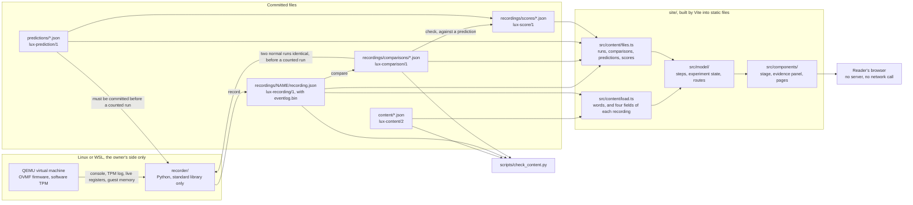

# Lux: engineering documentation

This is the entry point to the documentation of Lux as built. It describes the whole system, from the virtual machine to the page, and links the notes that go deeper. Where a deeper note already says something, this file points at it and does not repeat it.

| Document | What it holds |
|---|---|
| [`../README.md`](../README.md) | The question, the headline result with its limits, how to run the site and the recorder |
| [`DESIGN.md`](DESIGN.md) | The recorder: module boundaries, the recording, comparison, prediction and score formats, decisions D1 to D8, the risks and the test mix |
| [`RESULTS.md`](RESULTS.md) | The result of the four counted experiments: every row, the two numbers, the limits, and a second check of all of it |
| [`PILOTS.md`](PILOTS.md) | What each of the four pilots was observed to do. Pilots are shown and never counted |
| [`COUNTED.md`](COUNTED.md) | How each counted experiment was staged and how its one run is made. Written before the runs and kept as it was |
| [`MUTATION_CHECKS.md`](MUTATION_CHECKS.md) | Nine rules broken on purpose, and the tests that failed |
| [`VERIFICATION.md`](VERIFICATION.md) | The acceptance checks, the failures most likely to hurt a reader, the test counts per layer, what was checked by eye, the defects found, the release assessment, and the record of the deployment and of the walk of the live site |
| [`FRESH_CLONE_RUN.md`](FRESH_CLONE_RUN.md) | The README followed in a new clone: what was typed, what came back, what it found, and what was repeated after the README was corrected |
| [`../content/README.md`](../content/README.md) | The shape of the site's words as data, and every rule the content check enforces |
| [`../site/ASSETS.md`](../site/ASSETS.md) | How each picture was made and how a stop's picture is put together |
| [`../predictions/README.md`](../predictions/README.md) | What a prediction file is and which four exist |
| [`../recorder/testkeys/README.md`](../recorder/testkeys/README.md) | The public test keys and why they must never be trusted |

## 1. Purpose, reader, requirements

### 1.1 Purpose

Lux answers one question:

> When one thing in a PC's boot chain is changed, what does the specification require, what does it leave open, and what does this firmware actually do?

It answers it with evidence that a reader can check without installing anything: one boot of open-source UEFI firmware in a virtual machine, recorded to files; the same boot again with one thing changed; and a prediction for each counted change that was committed before the change was booted.

### 1.2 Intended reader

Someone who assesses system validation work, such as a hiring manager or a technical interviewer. That reader scrolls the story in a few minutes and then probes one stop or one experiment, so every statement on a screen must lead to the file and field it rests on. A second reader is anyone who wants to repeat the recordings on a Linux machine.

### 1.3 Requirements

| # | Requirement | Where it is met |
|---|---|---|
| R1 | The boot is told as seven stops. A screen holds one statement, one line from a recording, a citation marker and one control that opens the rest | `content/story-*.json`, `site/src/components/Stage.tsx` |
| R2 | Every claim carries a basis label: required by UEFI 2.11, left to the platform by UEFI 2.11, belonging to an unread Trusted Computing Group document, this firmware's own behaviour, read from a recording, or general background. A claim without a basis, or a UEFI basis without a full citation, fails a check | `scripts/check_content.py`, rules in `content/README.md` |
| R3 | An evidence line is copied letter for letter from the recording it names | `scripts/check_content.py`, rule `evidence` |
| R4 | A counted experiment has a prediction committed before its run, each row with a basis label. The result is two numbers: specification-required rows met, and open rows predicted correctly. A mismatch is reported; a prediction is never edited after its run | `recorder/prediction.py`, `recorder/runner.py`, `docs/DESIGN.md` section 6 |
| R5 | Two recordings of a normal run must be identical on every compared field before an experiment that changes that run counts | `recorder/compare.py`, `docs/DESIGN.md` section 5 |
| R6 | Experiments that were tried before any prediction existed are declared as pilots: shown, never counted | `recorder/experiments.py` (`kind`), `site/src/model/experiments.ts` |
| R7 | A run becomes a recording only if three readings of the same boot agree on all registers | `recorder/gate.py`, `docs/DESIGN.md` section 4.3 |
| R8 | The evidence is static. The site is built from committed files and a reader needs no virtual machine. The recorder is in the repository for anyone who wants to run it | `recordings/`, `site/src/content/load.ts`, `site/src/content/files.ts` |
| R9 | The story can be read without motion and by keyboard: a still page for reduced motion, one key press per step, a panel that keeps focus | `site/src/model/switches.ts`, `site/src/model/scene.ts`, `site/src/components/panel.ts` |
| R10 | Public sources only, vendor-neutral. No statement or supporting sentence names a product | `content/sources.json`, rule `names` of the content check |

The acceptance checks for these requirements, each as a concrete example mapped to a named test, are in [`VERIFICATION.md`](VERIFICATION.md) section 1.

### 1.4 Non-goals

| Non-goal | Why |
|---|---|
| Recording a real laptop or board | Real firmware is a vendor's code and not a public source. Every step of the virtual machine is meant to be repeatable on Ubuntu 24.04 with the pinned package versions; it has been repeated on one machine only. This is the largest limit of the project |
| Vendor-specific firmware behaviour | The project is vendor-neutral by rule |
| Hardware error handling | Out of scope |
| Anything after the handoff: kernel start-up, an operating system's own boot manager | The story ends when firmware steps back |
| An attack tutorial. No bypass of Secure Boot, no reproduction of a known vulnerability | Each experiment changes one thing on the project's own virtual machine to see how the protection reacts. That is validation |
| A live virtual machine in the browser | Readers see recorded evidence |
| A course with quizzes, progress or accounts; other languages; a polished phone version | The site is an explainer for a wide screen, readable on a phone |
| Measuring whether readers understand the story | No reader study was planned or run |

## 2. Architecture and data flow

Four parts, and files between them. The recorder never reads the content or the site, and the site never writes a file. One file flows back into the recorder: before a counted run it reads the comparison of the two normal runs.



### 2.1 The parts

| Part | Runs where | Reads | Writes |
|---|---|---|---|
| **Recorder** (`recorder/`) | Linux or WSL, with QEMU, OVMF and swtpm installed | The committed keys and loaders, the packaged firmware; for a counted run, its committed prediction and the comparison of the two normal runs | One `recording.json` and `eventlog.bin` per run; comparison files; score files |
| **Content** (`content/`) | Nowhere: it is data | | |
| **Content check** (`scripts/check_content.py`) | Any Python 3.12 | The content, the recordings and the comparison files | Nothing. It prints problems and exits 1 if there is one |
| **Site** (`site/`) | Built once by Vite; then any static file host, or `npm run dev` | The content, the recordings, comparisons, predictions and scores, all at build time | `dist/`, which is not committed |

### 2.2 Boundaries that matter

- **The virtual machine exists only on the recording side.** A reader's browser receives one script, one stylesheet, fonts and pictures. No address of another site is requested anywhere in the site's source; that was read from the source and the build output, not measured in a browser.
- **The site holds no fact of its own.** Words come from `content/` through `src/content/load.ts`; what has been run, compared, predicted and scored comes from the files through `src/content/files.ts`. Components hold labels of controls and a few fixed sentences about the state of the files, such as "No prediction is on file for this run." Every other sentence on the page is in the content, and a score that is not in a score file is not shown.
- **The content cannot quote what was not recorded.** The content check compares every evidence line with the field of the recording it names, character by character.
- **A recording cannot be made from a boot whose readings disagree**, and a counted recording cannot be made without a committed prediction. Both are refusals inside the recorder, before a file is written.
- **A picture is never evidence.** The board and the laptop are illustrations composed from the same few image files at every stop (`site/ASSETS.md`), and every screen says so.

### 2.3 Inside the recorder

The recorder's own pipeline, from preparation to score, is drawn in [`DESIGN.md`](DESIGN.md) section 2, and its modules are described in section 3. In short: `prepare` verifies keys and firmware and makes the variable store templates; `record` stages one run, boots it, ends it by pause, capture and kill, applies the agreement gate and the outcome rule, and writes the recording; `compare` writes the differences between a normal run and a changed run; `check` scores a comparison against a prediction.

### 2.4 Inside the site

| Folder | Role |
|---|---|
| `src/content/` | The two doors to the data. `load.ts` reads the five content files and, of every recording, the four fields the pages quote (`events`, `console`, `loader_report`, `pcrs`). `files.ts` reads which run each recording is, the comparison files, the predictions and the score files. `types.ts` is the shape of the content |
| `src/model/` | Plain functions over plain data, testable without a browser. `scene.ts` turns the content's screens into 22 steps, each a complete state of the picture. `experiments.ts` works out the state of an experiment from the files. `route.ts` and `switches.ts` read the address |
| `src/components/` | What is drawn. `Stage.tsx` draws one step. `EvidencePanel.tsx` draws everything behind "Open the evidence". `Experiments.tsx`, `Comparison.tsx`, `Sources.tsx` and `Overview.tsx` draw the other pages and the strip of seven stops |
| `src/stage/` | `useStepScroll.ts`: the step whose invisible marker is at the middle of the window is the current one |
| `src/styles/` | Two stylesheets. Motion is `transform` and `opacity` only, and a test enforces it |
| `tools/make_assets.py` | Makes the shipped pictures from source pictures that are not in the repository |

The story has three modes, chosen once in `src/main.tsx` before anything is drawn: scrolled and pinned; still sections (`?static`, or the reader prefers reduced motion); and frozen at one step (`?step=N`). The other two pages live after the hash sign of the same address, so a static host needs no rule for any address.

## 3. Two operations, traced end to end

### 3.1 A reader opens stop 6 and presses "Open the evidence"

The screen traced here is the headline screen of stop 6, `s6-verify`: "Before the loader runs, firmware checks who signed it." It is step 12 of the story, so `/?step=12` shows it frozen and `/?step=12&evidence` shows it with the panel open.

| # | What happens | Component | Data |
|---|---|---|---|
| 1 | The reader scrolls. The marker of step 12 crosses the middle of the window and becomes the current step | `src/stage/useStepScroll.ts` (an IntersectionObserver over one marker per step) | `STEPS[12]` in `src/model/scene.ts` |
| 2 | The step names its screen and the complete state of the picture: the board, with the parts lit that the screen lists | `stepOf` and `layersAt` in `src/model/scene.ts` | `content/story-c.json`, stop 6, screen `s6-verify`, field `picture` |
| 3 | The stage draws the count "6 of 7", the label, the statement with its emphasis, and the citation marker | `src/components/Stage.tsx` | The screen's `statement`; the marker's number from `claimNumbers` in `src/content/load.ts` |
| 4 | The stage draws the one evidence line: `PCR 7`, `EV_EFI_VARIABLE_AUTHORITY`, `variable db, 851 data bytes` | `EvidencePill` in `Stage.tsx` | The line is the screen's `evidence.text`. The content names its place: `recordings/normal-1/recording.json`, field `events[24].summary`, `event_index` 25. The register and the type are not in the content: `recordedEvent("normal-1", 25)` reads `pcr` and `type` from the recording |
| 5 | The reader presses "Open the evidence" | The button in `Stage.tsx` calls `onOpen(screen.id, openerId(step.id), false)` | |
| 6 | The panel state becomes open on that screen and remembers the control that opened it | `openPanel` in `src/components/panel.ts`, held in `App.tsx` | |
| 7 | The page behind the panel is put out of reach, and the panel takes focus | `App.tsx` sets `inert` on the navigation, the main part and the footer | |
| 8 | The panel shows the records the screen names: records 5, 6, 7, 8 and 25 of `normal-1`, and record 25 of the pilot `e5`, each with its register, type, line and SHA-256 digest | `Records` in `src/components/EvidencePanel.tsx` | The screen's `detail.events`; each record through `recordedEvent`, from `events[]` of the two recordings |
| 9 | The panel shows register 7 as it stood at the end of the run | `Registers` in `EvidencePanel.tsx` | `detail.pcrs`; the value through `recordedRegister("normal-1", "sha256", 7)`, from `pcrs.sha256["7"]` |
| 10 | The panel lists the screen's claims, each with its number, its basis label and its source. The first cites UEFI 2.11, section 32.5.1, PDF page 1633 | `EvidencePanel.tsx`; `claimSource` and `basisLabel` in `load.ts` | The screen's `claims`; the labels from `content/sources.json` `basis_labels` |
| 11 | The panel shows the terms, what the recording does not show, and where the stop's name comes from | `EvidencePanel.tsx` | `detail.definitions` (glossary entries or local terms), the stop's `not_shown`, the stop's `label_basis` |
| 12 | Escape, or the Close button, closes the panel. Focus returns to the control that opened it, and the page has not moved | `panelKey` and `closePanel` in `panel.ts`; the return of focus in `App.tsx` | |

Where the record came from: event 25 of `normal-1` was written by the firmware into its event log during the recorded boot. The recorder cut that log out of the saved guest memory (`recorder/capture.py`), parsed it (`recorder/eventlog.py`), confirmed that its replay equals the registers read from the software TPM (`recorder/gate.py`), and labelled the event with stop 6 by the rule `load-verify` (`recorder/storymap.py`). The type name `EV_EFI_VARIABLE_AUTHORITY` is the name a decoding tool prints, not a citation of a specification.

What guards this path: the content check fails if `variable db, 851 data bytes` is not exactly `events[24].summary` of that recording; the site's own `screenProblems` fails a test if the line is not that event's summary; and a site test renders the panel of every screen of the story (21) and requires every claim, term, line, digest and register the content names. The seven screens of the experiments and sources pages have panel tests for selected screens only.

A recording keeps each record's summary, size and digest, not its value. Where the story states a value (the `SecureBoot` byte, the bytes of `BootOrder`, the first bytes and names of the two boot options, and that the 851 bytes of this record are the end of the 879 bytes of the `db` variable), the claim's `field` names `eventlog.bin` beside the recording, and `recorder/tests/test_recorded_bytes.py` reads the value from that file with the recorder's parser and compares it with the sentence. The content check does not open `eventlog.bin`, so that test is the only guard of those sentences.

### 3.2 A counted experiment, from its prediction to the score on the page

The experiment traced here is `signature-byte`: one byte inside the signature value of the loader is changed, with Secure Boot on.

| # | What happens | Component | File or field |
|---|---|---|---|
| 1 | The prediction is written: 18 rows, each naming one field of a comparison, one expectation, a basis label and a reason; what would prove it wrong; the baseline recording by hash; and the parameter that decides which byte is changed | By hand, in the format of `docs/DESIGN.md` section 6 | `predictions/signature-byte.json`: `parameters.signature_area_offset` is 1490, `baseline.run` is `normal-1` |
| 2 | The prediction is committed | git | Commit `76ce581` |
| 3 | `python3 -m recorder record signature-byte-1 --experiment signature-byte --for-the-record` is run, once | `recorder/cli.py` | |
| 4 | The recorder refuses unless the command carries `--for-the-record`, the prediction is valid and describes the same change in the same words, the file on disk is byte for byte the one read out of its commit, and two identical recordings of `normal-1` are on file | `recorder/runner.py`, `recorder/prediction.py` (`require_committed`), `recorder/compare.py` | `recordings/comparisons/normal-1_vs_normal-2.json` |
| 5 | The run is staged: a copy of the signed loader with the lowest bit of the byte at file offset 40170 flipped, refused unless the file's own headers place that byte inside the signature value | `recorder/staging.py`, `recorder/loader.py`, `recorder/pe.py` | The offset comes from the committed prediction and from nowhere else |
| 6 | The machine boots. The firmware prints `Access Denied` and then that no boot option is left. After a quiet period the guest is paused, its memory saved, and the virtual machine killed while paused | `recorder/session.py` | |
| 7 | Three readings are compared: the replay of the event log, the replay of the TPM's own log, and the registers read from the TPM. They agree in all four hash banks | `recorder/capture.py`, `recorder/eventlog.py`, `recorder/gate.py` | `gate.passed` is true |
| 8 | The recording is written. It stores the change down to the byte, and the path, hash, commit and parameters of the prediction it ran under | `recorder/recording.py` | `recordings/signature-byte-1/recording.json`: `run.change_detail`, `provenance.prediction`, `outcome.result` is `refused` |
| 9 | `python3 -m recorder compare` puts the run beside `normal-1` | `recorder/compare.py` | `recordings/comparisons/normal-1_vs_signature-byte-1.json`: registers 4, 5 and 7 differ; the first differing event is 25 |
| 10 | `python3 -m recorder check ... --out` judges every row of the prediction against the comparison. It refuses if the prediction no longer has the hash the recording stores | `recorder/prediction.py` | `recordings/scores/signature-byte.json`: `required_met` 1 of `required_total` 1, `open_correct` 17 of `open_total` 17, `mismatches` empty, one verdict per row |
| 11 | The recording, the comparison and the score are committed | git | Commit `8be0f6f` |
| 12 | At build time the site finds every file that says it is a score | `SCORES` in `site/src/content/files.ts`: `import.meta.glob` over `recordings/scores/*.json` and over two places where no file lies (`results/*.json`, `recordings/*/score.json`); a file is kept only if its `format` is `lux-score/1` | |
| 13 | The headline numbers are the sum over the score files | `totals` in `site/src/model/experiments.ts` | 6 of 6 and 72 of 72, over four score files |
| 14 | The first screen of the experiments page shows the two numbers and how many experiments they are summed over | `site/src/components/Experiments.tsx` | |
| 15 | The card "signature byte" finds its two forms by name (`signature-byte`, `signature-byte-off`), and shows each as scored with its own two numbers | `experimentsOf`, `cardStates` and `experimentState` in `experiments.ts`; the card in `Experiments.tsx` | A recording belongs to an experiment by `run.experiment`, never by its folder name |
| 16 | Behind the card's control, the panel shows every row of the prediction with its basis label and whether it held, the comparison laid out from the two recordings, and the commit the run was scored under | `Prediction` in `site/src/components/Comparison.tsx`, `comparisonView` in `files.ts` | Prediction rows from the prediction file; verdicts from the score file's `rows` |

Two things in this chain are checked again by tests that run without a virtual machine: `test_committed_recordings.CountedRuns.test_each_score_file_follows_from_the_committed_files` makes each score again from the committed recording, comparison and prediction, and `test_the_two_numbers_are_the_sum_over_the_score_files` pins the two totals.

## 4. File formats

Five formats, each with a name and a version in its `format` field. All are JSON, UTF-8, LF line ends.

| Format | Files | Written by | Read by | Described in |
|---|---|---|---|---|
| `lux-recording/1` | `recordings/<run>/recording.json`, with the raw event log beside it as `eventlog.bin` | `recorder record` | `recorder compare` and `check`, the content check, the site | `DESIGN.md` section 4 |
| `lux-comparison/1` | `recordings/comparisons/<baseline>_vs_<changed>.json` | `recorder compare` | `recorder check`, the content check, the site | `DESIGN.md` section 5 |
| `lux-prediction/1` | `predictions/<experiment>.json` | By hand, before the run | `recorder record` and `check`, the site | `DESIGN.md` section 6 |
| `lux-score/1` | `recordings/scores/<experiment>.json` | `recorder check --out` | The site | `DESIGN.md` section 6.1 |
| `lux-content/2` | `content/story-a.json`, `story-b.json`, `story-c.json`, `experiments.json`, `sources.json` | By hand | The content check, the site | `content/README.md` |

Points that hold across formats:

- **Places are counted two ways, and each format says which.** An event's own `index` counts from 1. A place in a JSON array (`events[24]`, `console[0]`) counts from 0. Evidence in the content carries both: `position` 24 and `event_index` 25 are the same record.
- **Hashes are lowercase hexadecimal SHA-256**, unless a field names another bank.
- **A file names what it was made from by hash.** A score stores the hashes of the comparison, of both recordings, of the repeat comparison and of the prediction. A counted recording stores the hash and commit of its prediction. A prediction names its baseline recording by hash. So a file edited after the fact no longer fits the files that name it, and `check` refuses it.
- **`may_vary` in a recording is the complete list of fields a comparison ignores**: the recording time, the run's name and two durations.
- **The content never repeats what a file holds.** It names a run, a field and a position, and the site reads the value. The one exception is the evidence line itself, which is quoted so that a check can prove the quotation.

Two parts of the repository are binary and are evidence or inputs, not formats of this project: `eventlog.bin` (the firmware's event log as it lay in guest memory) and the files in `recorder/testkeys/` and `recorder/guest/` (keys, certificates, signature lists and the two signed loaders).

## 5. Decisions

Each decision gives its context, what was chosen, what was weighed against it, the consequences and a cost. A decision that was later replaced is kept and marked as superseded; it is not rewritten.

### 5.1 The recorder's decisions

These are written out in full in [`DESIGN.md`](DESIGN.md) section 8, and are not repeated here.

| # | Decision | Cost, in one line |
|---|---|---|
| D1 | The guest loader is assembly, built with the installed assembler | A Python reader must read assembly to trust the loader |
| D2 | The test keys are generated once and committed, private halves included | Private keys in a public repository; and the certificates are not yet valid at the guest's fixed clock |
| D3 | Every run ends by pause, capture, kill | A 512 MiB memory file per run, and an end condition that still rests on a quiet period |
| D4 | The variable store template is rebuilt by an enrolment boot and pinned by hash, not committed | Shown on one machine and one firmware package only |
| D5 | The enrolment program is machine code written out in Python | The one module a Python reader cannot check line by line |
| D6 | The boot order is written by the firmware in a preparation boot, into a store of its own | The boot order experiments have normal runs of their own; one more boot that can fail before the counted run |
| D7 | The second loader is a committed, signed artifact | A second signed binary; `LUX-LOADER B` means two different things in pilots and in boot order runs |
| D8 | The changed signature byte lies in the signature value, and is tried with Secure Boot on and off | `signature-byte-off` changes two things against its normal run |

Superseded in the recorder, as [`DESIGN.md`](DESIGN.md) section 11 records row by row:

| Earlier decision | Status |
|---|---|
| The boot order experiment reverses `BootOrder` by editing the store file while the machine is off | **Superseded by D6.** The offline edit was tested and found equivalent on this firmware, and still not used, because "the firmware accepted this write" would then be an argument and not an observation |
| The prediction gate asks git whether the file is tracked and unmodified | **Superseded.** The gate also reads the committed file out of git and compares hashes, because a file can be hidden from `git status` |
| The byte a signature experiment changes is a field of the experiment description | **Superseded.** It is a parameter of the committed prediction, so that it cannot be chosen after the prediction |
| A counted experiment with a committed prediction is started by `record` like any other run | **Superseded.** `record` needs `--for-the-record` |

### 5.2 Project-level decisions

#### P1. The question asks what is required, what is left open, and what this firmware does

*Context.* The project set out to compare a real boot with its specification. The chapters of UEFI 2.11 that the story needs were then read page by page, and the whole document was searched by keyword. It defines Secure Boot. It hands measured boot to Trusted Computing Group documents, assigns no purpose to any register, does not define the phase names SEC, PEI, DXE and BDS, and leaves several decisive behaviours to the platform in so many words.
*Chosen.* The question in section 1.1, and a basis label on every claim and every prediction row: required by UEFI 2.11 with section and page; left to the platform by UEFI 2.11 with section and page; belonging to a Trusted Computing Group document that was not read; this firmware's own behaviour. The content adds two labels for statements that are not about a rule: read from a recording, and general background. The result is reported as two numbers, one for the required rows and one for the open rows.
*Weighed.* Keeping a yes or no question (see the superseded decision below). Waiting until the Trusted Computing Group document could be read (it could not be obtained, and the project would have had no measured-boot content at all).
*Consequences.* A reader can tell a requirement from an observation on every screen. The content check refuses wording such as "the specification says" on a claim whose basis is an unread document or this firmware.
*Cost.* The headline is two numbers with caveats in place of one answer. Most rows fall under "this firmware", so the larger number says more about the firmware's consistency than about any specification. And every register and event statement on the site is an observation, because the document that would make it a requirement was not read.

> **Superseded: the first wording of the question.** "Do Secure Boot and measured boot react to a change the way the specifications say?" It was replaced by P1 because a yes or no cannot represent "the specification deliberately does not say", and because it would have claimed a reading of documents that were not read.

#### P2. One statement and one line of evidence on a screen; the rest behind one control

*Context.* The evidence for one screen is large: console lines, log records with digests, register values, claims with citations, definitions, and what the recording does not show. The intended reader scrolls first and probes second.
*Chosen.* A screen holds one statement of at most 14 words, at most one supporting sentence, one line copied from a recording, a citation marker, and "Open the evidence". Everything else is in a panel that any screen, card or section can open, and that has its own address (`/?step=N&evidence`, `#/experiments/<section>/evidence`).
*Weighed.* Showing specification, recording and measurement side by side on every screen (see the superseded decision below). Linking out to the raw files only (a reader would need to know the formats).
*Consequences.* The story reads in minutes, and nothing is lost: a site test renders the panel of every screen of the story (21) and requires every claim, term, line, digest and register the content names. The word limit is enforced by the content check.
*Cost.* The evidence is one press away, and a reader who never presses sees one line per screen. The panel needed its own focus and key rules, and those were the source of defects 10 and 11 in `VERIFICATION.md` section 5.

> **Superseded: three columns on every screen.** An earlier layout showed what the specification says, what the recording shows and what was measured in three columns, with no pictures. It was replaced by P2 because a screen was too dense to read while scrolling.

#### P3. A stop's picture is composed from two plates through per-part masks

*Context.* The story needs a picture of the machine at 22 steps, in which light spreads to the parts the boot has reached, and in which nothing moves between steps.
*Chosen.* Two pictures of one fictional board from one view, dark and fully lit. The page draws the dark one and stacks the lit one over it once per part, each copy cut out by a soft mask (eight parts, plus one mask for the whole board). A step only says which copies are seen. Which parts are lit at a screen is data in the content (`picture.lit`), not a property of an image file. Three pictures of one laptop, cut alike, serve the opening and the ending.
*Weighed.* One generated picture per stop (parts would drift between pictures, and a change of content would need a new picture). Drawing the board as vector graphics (no drift, but far from the look of a real board).
*Consequences.* A part never moves. A step is a complete state, so fast, backward or jumped scrolling lands on the right picture. Light never goes out along the story, and both the content check and a site test enforce that. Changing what a stop lights is a change of data.
*Cost.* The masks are polygons placed by hand in `site/tools/make_assets.py`, so the lit area of a part is an approximation of its outline. The source pictures are not in the repository, so the shipped pictures cannot be rebuilt from a clone. The pictures are illustrations and prove nothing; every screen has to say so.

#### P4. Experiments tried before any prediction are declared as pilots

*Context.* Four changed runs (`e1`, `e2`, `e4`, `e5`) had been tried before any prediction existed, so the measure "prediction before run" cannot apply to them.
*Chosen.* They are recorded with the same recorder, shown on the site with the label "pilot", and counted in no number. The counted set is what had not been run when its prediction was committed.
*Weighed.* Leaving them out (the reader would not know that the predictions were written with them in sight). Counting them with predictions written afterwards (not a prediction).
*Consequences.* The site can show the clearest case, one byte changed with Secure Boot on, as a two-run screen without claiming it as a result.
*Cost.* The counted predictions were written with the pilots in sight, and most of their rows predict a repeat of what a pilot or a normal run had shown. `RESULTS.md` says so beside the numbers.

#### P5. The site shows the state of the files, not a sentence about them

*Context.* A sentence such as "not yet run" goes stale the moment a recording is committed.
*Chosen.* What has been run, compared, predicted and scored is worked out at build time from `recordings/`, `predictions/` and the score files (`site/src/model/experiments.ts`): not run, pilot, recorded, or scored. The headline score is the sum over the score files, and with no score file the page claims no score.
*Weighed.* Writing the status and the numbers into the content (simpler, and the content check could verify them, but two places would have to change together).
*Consequences.* The page cannot show a score that is not on file, and tests cover the page with nothing on file, with a pilot and with a score.
*Cost.* Every recording is part of the site's script, which is about 940 kB before compression and grows with each recording. The content still carries a few status sentences beside the files' state, and those must be kept true by hand.

## 6. Operating guidance

### 6.1 Setup

| To do this | You need | Network |
|---|---|---|
| Read the evidence | Nothing. The recordings, comparisons, scores and predictions are text files | None |
| Run the site locally | Node.js 22.12 or later in the 22 line, 24, or 26 and later (only 24 was used). `npm ci` in `site/` | `npm ci` downloads the packages pinned in `site/package-lock.json` once. After that, none |
| Run the recorder's unit tests and the content check | Python 3.12, standard library only. `git` for three tests, which are skipped without it | None |
| Record a run | Ubuntu 24.04, or WSL 2 with it, and the packages `qemu-system-x86`, `ovmf`, `swtpm`, `binutils`, `python3`, `git` | The packages are installed once with the system's package manager. After that, none |
| Rebuild the pictures | Python with Pillow, and the source pictures, which are not in the repository | None |

There is no configuration file and no secret. Four environment variables exist: `LUX_WORK_DIR` (where the recorder keeps its scratch files, default `~/lux-work`), `LUX_VM_TESTS=1` (include the tests that boot a virtual machine), and for a published build `LUX_BASE` and `LUX_SITE_URL` (`README.md`, "Hosting", and section 6.7).

### 6.2 Run

The commands, with their expected output, are in [`../README.md`](../README.md). In short, from the repository root:

```
python3 -m recorder prepare
python3 -m recorder record my-normal --experiment normal --out scratch
python3 -m recorder compare recordings/normal-1/recording.json scratch/my-normal/recording.json --out scratch/normal-1_vs_my-normal.json
```

`scratch/` is ignored by git and by the tests. A run of your own written into `recordings/` makes one unit test fail until it is deleted.

and from `site/`:

```
npm ci
npm run dev
```

### 6.3 Tests

The commands are written as on Linux or WSL. On Windows the first and the third run with `python` in place of `python3`.

| Command | From | What it runs |
|---|---|---|
| `python3 -m unittest discover -s recorder/tests -t .` | repository root | The recorder's tests. Six are skipped unless `LUX_VM_TESTS=1` |
| `bash scripts/test-with-vm.sh` | repository root, on a prepared Linux machine | The same with the six tests that boot normal runs, then a check that nothing is left running |
| `python3 scripts/check_content.py` | repository root | The content check |
| `npm test` | `site/` | The site's tests |
| `npm run build` | `site/` | The type check, then the production build |
| `npm run format:check` | `site/` | Prettier over the site |

`.github/workflows/check.yml` runs all of these except the second on a hosted runner, on every push and pull request. `.github/workflows/deploy.yml` runs the last four again before it publishes (section 6.7). [`VERIFICATION.md`](VERIFICATION.md) section 3 gives the counts and the last results.

### 6.4 Troubleshooting

| Symptom | Cause and remedy |
|---|---|
| `prepare` says the firmware file differs from the pinned one | Another version of the `ovmf` package is installed. The recordings were made with `2024.02-2ubuntu0.10`. The recorder refuses on purpose: with another firmware every register differs and nothing would be comparable |
| `prepare` says this assembler and linker build a different loader | Another `binutils` version produced other bytes than the ones the committed signed loader was made from. `prepare` stops there and makes no template, so nothing can be recorded on that machine with those tools; recordings would not be comparable |
| Sockets fail, or a run cannot start, under WSL | The work directory is on a Windows drive. Set `LUX_WORK_DIR` to a path on the Linux file system. The repository itself may live anywhere |
| `record` says the recording exists | A name is never written over. Use another name, or `--out` another folder. `--replace` overwrites on purpose, and never a counted recording |
| `record` exits with code 3 | A changed run reached neither the loader's last line nor a refusal, and was recorded as `timeout`. That is a result, not an error |
| `record` says the agreement gate failed | The three readings of the boot disagree. Nothing was written. Run `bash scripts/check-clean.sh` and try again; if it repeats, the tool versions differ from the ones in `README.md` |
| `check` refuses to score | The comparison was not made from the recording or the baseline given, the prediction file is not the one the run was recorded under, or the repeat comparison is missing. The sentence printed says which |
| A virtual machine seems to be left running | `bash scripts/check-clean.sh` reports any `qemu-system` or `swtpm` process and any leftover guest memory file |
| `npm run dev` or `npm run preview` fails to start | Port 5183 is fixed and strict, and something else is using it. Add `-- --port 5191`, or any free port, to the command |
| A build with `LUX_BASE=/lux/` in Git Bash on Windows has wrong paths | The shell rewrites an argument that begins with a slash. Set `MSYS_NO_PATHCONV=1` for that command |
| The content check fails after an edit to the content | It prints one line per problem with the rule's code. `content/README.md`, "What the check refuses", explains each code |

### 6.5 Resetting run directories

The recorder's scratch files live in the work directory (`~/lux-work`, or `LUX_WORK_DIR`): `template/` holds the variable store templates that `prepare` made, and `runs/<name>/` holds what each boot used and left behind (the boot disk, the copy of the store, the logs).

- **On a machine of your own**, the whole work directory can be deleted at any time. `python3 -m recorder prepare` makes the templates again and refuses them if their hashes are not the pinned ones.
- **A single run directory** can be deleted once its recording is written. Guest memory is deleted by the recorder itself.
- **On the machine that made the counted runs**, the run directories of the four counted runs are the local trace that each was booted once (`RESULTS.md`, "Checked a second time"). They are not in the repository and are worth keeping.
- Nothing in the work directory is needed to read the evidence, run the tests or build the site.

### 6.6 What must never be made again

| Never | Why |
|---|---|
| Boot a counted experiment a second time, or pass `--for-the-record` to try the command | Each was booted once, by rule. A second boot is a repetition under another name, not the counted run |
| Edit a file in `predictions/` | A prediction is never edited after its run. The recordings and scores store its hash, and `check` refuses an edited one |
| Regenerate the keys in `recorder/testkeys/`, or sign the loaders again | Register 7 depends on the certificate bytes, and a signature is not repeatable. Every recording would stop being reproducible |
| Replace `recordings/normal-1`, `normal-2` or a two-entry normal run in a checkout you mean to commit | The predictions and the scores name their baseline recordings by hash. `scripts/record-pilots.sh` and `scripts/record-baselines.sh` do replace them, on purpose, for a reader who wants to see the runs repeat; the recording time changes, so the files then differ from the committed ones even when every compared field is equal |
| Rewrite the fixtures in `recorder/tests/fixtures/` | They are real output of two boots and pin the two undocumented formats the recorder depends on |
| Overwrite the pictures in `site/src/assets/` and `site/public/og.jpg` without the source pictures | They cannot be rebuilt from a clone |
| Record a run on a hosted runner, or add a step to a workflow that boots a virtual machine | The recordings are committed evidence, made once on one machine with pinned tool versions. A runner has other versions, and a recording made there would not be comparable. Both workflows only read what is committed |

### 6.7 Publishing the site

The site is published on GitHub Pages at `https://lejie710.github.io/lux/`. Nobody publishes by hand: `.github/workflows/deploy.yml` does it.

| Question | Answer |
|---|---|
| What starts it | A push to `main`, or the workflow started by hand from the repository's Actions page. A push to another branch and a pull request only start `check.yml`, which publishes nothing |
| What it runs | `python3 scripts/check_content.py`, then in `site/`: `npm ci`, `npm run format:check`, `npm test`, `npm run build`. Then it uploads `site/dist/` and deploys it |
| What a failing step does | It stops the run. Nothing is uploaded, so a change that the content check, the formatter, the tests or the type check reject is not published |
| The two environment values | `LUX_BASE=/lux/`, the folder the site is served from: asset paths and the link in `404.html` start there. `LUX_SITE_URL=https://lejie710.github.io/lux/`, the full public address, which the link-preview tags need for the picture's absolute address. Both are set in the workflow file and nowhere else; a move to another address means changing both there |
| The one setting outside the repository | Settings, Pages, Source must be "GitHub Actions". Without it the step `actions/configure-pages` fails, as it did on the first run |
| What it never does | It boots no virtual machine, records no run and writes nothing back to the repository. Its permissions are to read the contents and to write to Pages |
| What a push to `main` means | Every push to `main` that passes the checks replaces the public site, a push that changes only a document included. Run the four site and content commands of section 6.3 locally before a push |
| After a deployment | Open the address in a new browser profile and look. [`VERIFICATION.md`](VERIFICATION.md) section 12 records the first deployment and what was looked at |

The host compresses text with gzip and sets a cache lifetime of ten minutes on every file; neither can be changed from the repository.
